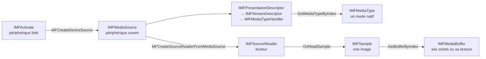

# Les API Windows utilisées par HdmiScreen

Ce document explique les quatre familles d'API sur lesquelles repose le projet, dans l'ordre où on les rencontre : **Win32** (la fenêtre), **COM** (le modèle d'objets commun à presque toutes les API Windows modernes), **Media Foundation** (la capture vidéo) et **Direct3D 11 / DXGI** (l'affichage par le GPU). Une dernière partie explique les formats vidéo.

Dans le code, chaque appel d'API important est précédé d'un commentaire `// [API] ...`. Le tableau de la [section 6](#6-index--quelle-api-dans-quel-fichier) indique dans quel fichier trouver chaque API.

Toutes ces API sont écrites pour le C et le C++. Il n'existe pas de « JDK Windows » : on appelle directement les fonctions du système, documentées sur [learn.microsoft.com](https://learn.microsoft.com/fr-fr/windows/win32/). Pour débuter, le tutoriel officiel [Bien démarrer avec Win32 et C++](https://learn.microsoft.com/fr-fr/windows/win32/learnwin32/learn-to-program-for-windows) couvre très bien les §1 et §2.

---

## 1. Win32 : la fenêtre et la boucle de messages

**Fichiers : `MainWindow.cpp`, `App.cpp` (boucle), `main.cpp`.**

Win32 est l'API historique de Windows (1993), toujours la base de toute application de bureau. Elle n'est pas orientée objet : ce sont des fonctions C qui manipulent des **handles** (`HWND` pour une fenêtre, `HANDLE` pour un événement…), des identifiants opaques comparables à des descripteurs de fichiers.

### 1.1 Créer une fenêtre

Deux étapes, dans `MainWindow::MainWindow` :

1. **`RegisterClassExW`** déclare une *classe de fenêtre* : un modèle qui donne un nom, une icône, un curseur et surtout la **procédure de fenêtre**, la fonction qui recevra les événements. Malgré son nom, cette « classe » n'a rien à voir avec une classe C++ ou Java.
2. **`CreateWindowExW`** crée une fenêtre de cette classe, avec un *style* (`WS_OVERLAPPEDWINDOW` = fenêtre normale avec bordure et titre, `WS_POPUP` = sans aucune décoration).

Le suffixe **W** (`CreateWindowExW`) désigne la version Unicode (chaînes UTF-16, `wchar_t`). La version **A** utilise la page de code locale ; on ne s'en sert plus. Le projet définit `UNICODE` pour que les macros sans suffixe pointent vers les versions W.

### 1.2 Messages et procédure de fenêtre

Windows communique avec la fenêtre par **messages** : un entier (`WM_KEYDOWN`, `WM_SIZE`…) et deux paramètres (`wParam`, `lParam`) dont le sens dépend du message. Il n'y a pas d'objets événements typés comme en Swing ou JavaFX.

| Message | Quand | Ce qu'en fait HdmiScreen |
| --- | --- | --- |
| `WM_NCCREATE` | Tout premier message de la fenêtre | Mémorise le pointeur `this` (voir §1.3) |
| `WM_SIZE` | La fenêtre change de taille | Redimensionne la swap chain |
| `WM_KEYDOWN` | Touche enfoncée (`wParam` = code `VK_*`) | Échap, F11, S, R, traduits en commandes |
| `WM_COMMAND` | Choix dans la barre de menus (`LOWORD(wParam)` = identifiant) | Transmis à `App::onCommand` |
| `WM_CONTEXTMENU` | Clic droit, touche Menu ou Maj+F10 | Affiche le menu contextuel |
| `WM_ENTERMENULOOP` / `WM_EXITMENULOOP` | Un menu s'ouvre / se ferme | Le curseur reste visible pendant ce temps |
| `WM_MOUSEMOVE` | La souris bouge | Réaffiche le curseur, relance le minuteur |
| `WM_TIMER` | Un minuteur (`SetTimer`) expire | Masque le curseur |
| `WM_SETCURSOR` | Windows demande quel curseur afficher | Aucun, s'il doit être masqué |
| `WM_ERASEBKGND` | Windows veut effacer le fond | Ignoré : Direct3D dessine tout |
| `WM_DESTROY` | La fenêtre est détruite | `PostQuitMessage` : fin de la boucle |
| `WM_NCDESTROY` | Tout dernier message | Défait le lien fenêtre ↔ objet C++ |

Tout message non traité doit être transmis à **`DefWindowProcW`**, qui applique le comportement standard (déplacement, Alt+F4, etc.).

### 1.3 Relier une fenêtre à un objet C++

La procédure de fenêtre est une **fonction C** : Windows l'appelle sans aucun `this`. Pour retrouver notre objet `MainWindow`, on utilise une technique classique :

1. on passe `this` comme dernier paramètre de `CreateWindowExW` ;
2. dans `WM_NCCREATE`, Windows nous le rend dans `lParam` ; on le range dans la fenêtre avec `SetWindowLongPtrW(hwnd, GWLP_USERDATA, …)` ;
3. aux messages suivants, on le relit avec `GetWindowLongPtrW` et on appelle la méthode `handleMessage`.

C'est l'équivalent de ce que fait un `ActionListener` Java, mais construit à la main. Voir aussi [CPP_POUR_DEV_JAVA.md §10](CPP_POUR_DEV_JAVA.md#10-fonctions-de-rappel-callbacks-c-et-pointeur-this).

### 1.4 La boucle de messages

Les messages s'accumulent dans une file propre au thread qui a créé la fenêtre. Ce thread doit les retirer et les distribuer en boucle, sinon la fenêtre « ne répond plus ». La boucle classique est :

```cpp
MSG msg;
while (GetMessageW(&msg, nullptr, 0, 0)) {   // attend un message
    TranslateMessage(&msg);
    DispatchMessageW(&msg);                   // appelle la procédure de fenêtre
}
```

HdmiScreen doit attendre **deux** choses : les messages ET l'arrivée d'une image. `App::run` utilise donc **`MsgWaitForMultipleObjectsEx`**, qui rend la main dès qu'un message arrive, qu'un objet noyau (notre événement « nouvelle image ») est signalé, ou que le délai (250 ms) expire. On vide ensuite la file avec `PeekMessageW` (non bloquant). Le CPU reste à 0 % entre deux événements.

### 1.5 Autres appels Win32 du projet

| API | Rôle |
| --- | --- |
| `SetProcessDpiAwarenessContext(…PER_MONITOR_AWARE_V2)` | Travailler en pixels physiques. Sans cela, sur l'écran 2880×1800 à 200 %, Windows ferait croire à l'appli qu'il mesure 1440×900 et agrandirait lui-même l'image, avec du flou. |
| `MonitorFromWindow`, `GetMonitorInfoW` | Taille de l'écran, pour le plein écran et le choix du mode |
| `SetWindowLongPtrW(GWL_STYLE)`, `SetWindowPos` | Passer de fenêtré à plein écran sans bordure |
| `CreateEventW`, `SetEvent`, `WaitForSingleObject` | Événements noyau : un thread signale, un autre attend |
| `SetThreadExecutionState` | Empêcher la mise en veille de l'écran |
| `CommandLineToArgvW` | Découper la ligne de commande en arguments |
| `AttachConsole`, `WriteConsoleW` | Écrire dans l'invite de commandes qui a lancé le programme |
| `OutputDebugStringW` | Journal visible dans Visual Studio (fenêtre Sortie) ou DebugView |
| `GetLocalTime` | Heure locale pour horodater le journal |
| `SetWindowTextW` | Titre de la fenêtre (boîtier et mode en cours) |
| `MessageBoxW` | Boîtes « Raccourcis clavier » et « À propos » |
| `GetModuleFileNameW` | Chemin de l'exécutable, pour placer `hdmiscreen.ini` à côté |

### 1.6 Menus

**Fichiers : `App.cpp` (section « Menus et commandes »), `MainWindow.cpp`, `Commands.h`.**

Un menu Win32 est un objet système désigné par un handle `HMENU`. Chaque élément porte un **identifiant de commande** entier, renvoyé quand l'utilisateur le choisit. Il n'y a pas d'objet « action » avec un écouteur comme en Swing : tout passe par cet identifiant, défini dans `Commands.h`.

Il existe deux façons de créer des menus :

- les décrire dans un **fichier de ressources `.rc`**, compilé et intégré à l'exécutable. C'est la façon classique pour des menus fixes, éditables dans Visual Studio ;
- les **construire par programme**. HdmiScreen procède ainsi, parce que les menus *Périphérique* et *Mode* dépendent du matériel branché.

| API | Rôle |
| --- | --- |
| `CreateMenu` | Crée une barre de menus (vide) |
| `CreatePopupMenu` | Crée un menu déroulant : sous-menu ou menu contextuel |
| `AppendMenuW(menu, MF_STRING, id, texte)` | Ajoute un élément ; `MF_CHECKED` le coche, `MF_GRAYED` le désactive, `MF_SEPARATOR` ajoute un trait |
| `AppendMenuW(menu, MF_POPUP, (UINT_PTR)sousMenu, texte)` | Ajoute un sous-menu ; le parent en devient propriétaire |
| `SetMenu(hwnd, menu)` | Attache la barre à la fenêtre (`nullptr` la retire, comme en plein écran) |
| `TrackPopupMenu(menu, TPM_RETURNCMD, x, y, …)` | Affiche un menu contextuel et, avec `TPM_RETURNCMD`, renvoie directement l'identifiant choisi (0 si aucun) |
| `DestroyMenu` | Détruit un menu et tous ses sous-menus |

Conventions d'écriture des libellés : `&` souligne la lettre d'accès (Alt+lettre), et le texte placé après une tabulation `\t` s'affiche aligné à droite, pour indiquer le raccourci clavier (`L"&Plein écran\tF11"`).

**Propriété des menus, un piège classique.** Un menu attaché à une fenêtre est détruit avec elle. HdmiScreen retire sa barre en plein écran puis la remet : `MainWindow` en reste donc propriétaire, la détache dans `WM_DESTROY` et la détruit elle-même dans son destructeur. Sans ce détachement, le menu serait détruit deux fois.

### 1.7 Fichiers .ini

**Fichier : `SettingsFile.cpp`.**

Win32 fournit depuis toujours des fonctions pour les fichiers de configuration au format `.ini` (sections `[nom]` et lignes `clé=valeur`) :

| API | Rôle |
| --- | --- |
| `GetPrivateProfileStringW(section, clé, défaut, tampon, taille, fichier)` | Lit une valeur ; renvoie `défaut` si le fichier, la section ou la clé n'existe pas |
| `WritePrivateProfileStringW(section, clé, valeur, fichier)` | Écrit ou remplace une valeur ; crée la section et le fichier si besoin |

Ces fonctions relisent et réécrivent le fichier à chaque appel : c'est lent mais sans importance pour quelques réglages. Elles ont une **subtilité d'encodage** : un fichier qu'elles créent elles-mêmes est en ANSI (page de code locale), et un nom accentué comme « Caméra virtuelle » serait abîmé. Si le fichier commence par la marque UTF-16 (BOM, octets `FF FE`), elles lisent et écrivent en Unicode. `SettingsFile.cpp` crée donc le fichier lui-même avec ce BOM (`CreateFileW` + `WriteFile`) avant la première écriture.

Pour des réglages plus riches, on utiliserait plutôt le registre Windows (`RegSetValueExW`) ou un fichier JSON ; le `.ini` a l'avantage d'être lisible et modifiable dans le Bloc-notes.

---

## 2. COM : le modèle d'objets de Windows

**Fichiers : `ComUtils.h`, `CaptureSession.cpp` (implémentation d'un objet COM).**

### 2.1 Pourquoi COM

Media Foundation, Direct3D, DXGI : toutes ces API exposent des **objets** et non des fonctions. Elles le font avec **COM** (*Component Object Model*), une norme binaire des années 1990 qui permet à du code compilé par des compilateurs différents (voire des langages différents) d'échanger des objets.

Un objet COM n'est accessible qu'au travers d'**interfaces**, dont le nom commence par `I` : `IMFSourceReader`, `ID3D11Device`… Côté C++, une interface est une classe dont toutes les méthodes sont virtuelles pures. C'est très proche d'une interface Java, à trois différences près, détaillées ci-dessous.

### 2.2 IUnknown : comptage de références et découverte d'interfaces

Toute interface COM hérite de **`IUnknown`**, qui a trois méthodes :

| Méthode | Rôle | Équivalent Java approximatif |
| --- | --- | --- |
| `AddRef()` | +1 au compteur de références | (géré par le GC) |
| `Release()` | −1 ; l'objet se détruit à 0 | (géré par le GC) |
| `QueryInterface(iid, &ptr)` | « Implémentes-tu cette autre interface ? » | `instanceof` + cast |

**Première différence avec Java : il n'y a pas de ramasse-miettes.** Chaque détenteur d'un pointeur COM doit appeler `Release` quand il n'en a plus besoin. Un `Release` oublié est une fuite ; un de trop, un plantage. En pratique, on ne les appelle jamais à la main : on utilise **`ComPtr`** (§2.5).

**Deuxième différence : `QueryInterface`.** Un même objet peut implémenter plusieurs interfaces, mais on ne peut pas « caster » un pointeur COM vers une autre interface. Il faut lui demander. Dans le projet, `ComPtr::As(&autre)` fait cet appel ; par exemple le contexte D3D11 est interrogé pour obtenir son interface vidéo (`ID3D11VideoContext`).

Les interfaces sont identifiées par un **GUID** (identifiant de 128 bits), appelé ici IID. `__uuidof(IMFSample)` et la macro `IID_PPV_ARGS(&ptr)` fournissent cet identifiant.

### 2.3 HRESULT : les erreurs

**Troisième différence : COM ne lève jamais d'exception.** Chaque méthode renvoie un **`HRESULT`**, un entier 32 bits : négatif = échec (macro `FAILED(hr)`), positif ou nul = succès (`SUCCEEDED(hr)`). Les valeurs les plus courantes sont `S_OK` (0), `E_FAIL`, `E_INVALIDARG`, `E_POINTER`, `E_NOINTERFACE`. Media Foundation définit les siennes (`MF_E_*`, dans `mferror.h`) et DXGI aussi (`DXGI_ERROR_*`).

Le projet convertit ces codes en exceptions C++ avec `throwIfFailed(hr, "contexte")` (`ComUtils.h`). Le message garde le code en hexadécimal : on peut le chercher sur le web ou avec l'outil « Error Lookup » de Visual Studio.

### 2.4 Implémenter un objet COM : `CaptureSession`

D'habitude on *utilise* des objets COM. Mais pour recevoir les images en mode asynchrone, Media Foundation demande un objet qui implémente `IMFSourceReaderCallback` : il faut alors *écrire* un objet COM. C'est le passage le plus bas niveau du projet :

- `CaptureSession` hérite de `IMFSourceReaderCallback` (qui hérite de `IUnknown`) ;
- `AddRef`/`Release` gèrent un compteur `std::atomic<ULONG>`, car Media Foundation appelle depuis plusieurs threads ; à zéro, l'objet fait `delete this` ;
- `QueryInterface` répond pour `IUnknown` et `IMFSourceReaderCallback`, et `E_NOINTERFACE` pour le reste ;
- le constructeur et le destructeur sont **privés** : on ne crée l'objet que par `CaptureSession::create` (compteur à 1, confié à un `ComPtr` via `Attach`), et seul `Release` le détruit ;
- les méthodes de rappel ne doivent **jamais laisser sortir d'exception** : l'appelant est du code système qui ne sait pas les gérer.

**Piège du cycle de références.** Le lecteur garde une référence sur la session (son callback), et la session garde une référence sur le lecteur. Sans intervention, aucun des deux compteurs ne tomberait à zéro. `CaptureSession::stop()` casse le cycle en libérant le lecteur. Avec un ramasse-miettes Java, ce cycle serait collecté automatiquement ; avec le comptage de références, c'est au programmeur d'y penser.

### 2.5 `ComPtr` : le pointeur intelligent COM

`Microsoft::WRL::ComPtr<T>` (en-tête `<wrl/client.h>`, fourni avec le SDK Windows) appelle `AddRef` quand on le copie et `Release` quand il est détruit ou réaffecté. Les opérations utilisées dans le projet :

| Écriture | Effet |
| --- | --- |
| `ComPtr<IMFSample> s;` | Pointeur vide |
| `api->Create(&s)` | `&` donne l'adresse du pointeur interne ; l'API y dépose l'objet, déjà compté |
| `s.Get()` | Pointeur brut, pour le passer à une API (sans changer le compteur) |
| `s.Reset()` | `Release` et remise à vide |
| `a = b;` | Copie : `AddRef` |
| `a = std::move(b);` | Transfert : ni `AddRef` ni `Release`, `b` devient vide |
| `s.As(&autre)` | `QueryInterface` typé |
| `s.Attach(p)` | Adopte un pointeur déjà compté (sans `AddRef`) |

### 2.6 Initialiser COM : `CoInitializeEx`

Chaque thread qui utilise COM doit appeler `CoInitializeEx` (et `CoUninitialize` à la fin) : c'est le rôle de la classe RAII `ComInitializer` dans `main.cpp`. Le thread principal est déclaré **STA** (*single-threaded apartment*), le mode requis pour un thread qui possède des fenêtres. Les threads internes de Media Foundation ont leur propre initialisation ; on n'a pas à s'en occuper.

Les chaînes ou tableaux **alloués par une API COM** pour nous se libèrent avec `CoTaskMemFree` (cf. `CoTaskString` dans `ComUtils.h` et le tableau renvoyé par `MFEnumDeviceSources`).

---

## 3. Media Foundation : la capture vidéo

**Fichiers : `CaptureDevices.cpp`, `CaptureSession.cpp`.** Documentation : [Media Foundation](https://learn.microsoft.com/fr-fr/windows/win32/medfound/microsoft-media-foundation-sdk).

Media Foundation (MF) est l'API multimédia de Windows depuis Vista. Elle remplace DirectShow, et l'appli Caméra de Windows s'en sert. Le boîtier HDMI est un périphérique **UVC** (*USB Video Class*) : Windows le voit comme une webcam, avec son pilote standard.

### 3.1 Les objets, du périphérique à l'image



| Objet | Rôle |
| --- | --- |
| `IMFAttributes` | Dictionnaire clé (GUID) → valeur. Sert à passer des options à presque toutes les fonctions MF. |
| `IMFActivate` | Un périphérique énuméré mais pas encore ouvert : nom, lien symbolique |
| `IMFMediaSource` | Le périphérique ouvert. Il ne produit rien tant qu'un lecteur ne le démarre pas. |
| `IMFMediaTypeHandler` | Liste les **types natifs** d'un flux (ses modes) et sélectionne le mode courant |
| `IMFMediaType` | Un format : type majeur (vidéo), sous-type (NV12, YUY2, MJPG), taille, fréquence… |
| `IMFSourceReader` | Le lecteur : démarre la source, insère si besoin un décodeur et livre les images |
| `IMFSample` | Une image, avec son horodatage |
| `IMFMediaBuffer` / `IMF2DBuffer` / `IMFDXGIBuffer` | Le contenu de l'image : en mémoire CPU (1D ou 2D) ou dans une texture GPU |
| MFT (*Media Foundation Transform*) | Un composant de traitement (décodeur, convertisseur). Le lecteur l'insère tout seul ; on ne le manipule pas directement. |

### 3.2 Le déroulé dans le code

1. **`MFStartup`** (classe `MediaFoundationInitializer`) : obligatoire avant tout appel MF.
2. **`MFEnumDeviceSources`** avec l'attribut `MF_DEVSOURCE_ATTRIBUTE_SOURCE_TYPE_VIDCAP_GUID` : liste les périphériques vidéo. On lit leur nom (`MF_DEVSOURCE_ATTRIBUTE_FRIENDLY_NAME`) et leur **lien symbolique**, identifiant stable qui sert à les rouvrir (`MFCreateDeviceSource`).
3. **Lecture des modes** : `CreatePresentationDescriptor` → `GetStreamDescriptorByIndex(0)` → `GetMediaTypeHandler` → `GetMediaTypeByIndex(i)`. Pour chaque type, on lit `MF_MT_SUBTYPE`, `MF_MT_FRAME_SIZE` et `MF_MT_FRAME_RATE`. Ces deux derniers stockent deux entiers 32 bits dans un 64 bits ; `MFGetAttributeSize` et `MFGetAttributeRatio` les extraient.
4. **Choix du mode** (logique pure, `Selection.cpp`), puis `IMFMediaTypeHandler::SetCurrentMediaType` pour placer le boîtier dans ce mode.
5. **Création du lecteur** `MFCreateSourceReaderFromMediaSource`, avec les attributs :
   - `MF_SOURCE_READER_ASYNC_CALLBACK` : mode asynchrone, les images arrivent dans `OnReadSample` ;
   - `MF_SOURCE_READER_D3D_MANAGER` : le gestionnaire D3D partagé avec le rendu (§4.6) ;
   - `MF_READWRITE_ENABLE_HARDWARE_TRANSFORMS` : autorise les décodeurs matériels ;
   - `MF_LOW_LATENCY` : pas de mise en tampon.
6. **Format de sortie** : `IMFSourceReader::SetCurrentMediaType`. Si le boîtier envoie du MJPEG, on demande du NV12 : le lecteur insère lui-même le décodeur MJPEG (matériel si possible).
7. **Boucle asynchrone** : `ReadSample` demande une image et rend la main ; MF appelle `OnReadSample` sur un de ses threads ; on garde l'image et on redemande aussitôt la suivante. Voir [Utiliser le Source Reader en mode asynchrone](https://learn.microsoft.com/fr-fr/windows/win32/medfound/using-the-source-reader-in-asynchronous-mode).
8. **Arrêt** : `Flush` annule la demande en cours, MF confirme par `OnFlush`, puis on libère le lecteur, qui arrête le périphérique.

### 3.3 Pourquoi le mode asynchrone

En mode synchrone, `ReadSample` bloque jusqu'à l'arrivée de l'image : il faudrait un thread dédié qui boucle, plus une synchronisation avec le thread UI. En mode asynchrone, Media Foundation fournit déjà ses threads et nous rappelle : le code se réduit à « garder la dernière image et réveiller l'UI ».

---

## 4. Direct3D 11 et DXGI : l'affichage par le GPU

**Fichier : `Renderer.cpp`.** Documentation : [Direct3D 11](https://learn.microsoft.com/fr-fr/windows/win32/direct3d11/atoc-dx-graphics-direct3d-11), [modèle flip DXGI](https://learn.microsoft.com/fr-fr/windows/win32/direct3ddxgi/dxgi-flip-model).

### 4.1 Qu'est-ce que Direct3D 11 ?

**Direct3D est l'API de Windows pour programmer la carte graphique (GPU).** Elle fait partie de la famille **DirectX** (Direct3D pour la 3D et le GPU en général, Direct2D pour le dessin 2D, DirectWrite pour le texte…). C'est l'équivalent Windows d'OpenGL ou de Vulkan.

On l'associe aux jeux vidéo, mais c'est en réalité la voie d'accès générale au GPU sous Windows : le bureau lui-même (le compositeur DWM), les navigateurs, les lecteurs vidéo et l'appli Caméra s'en servent. Le GPU sait faire très vite trois choses dont on a besoin ici :

- **convertir les couleurs** : le boîtier envoie du YUV, l'écran attend du RGB ;
- **mettre à l'échelle** : 1920×1080 vers 2880×1620, avec un filtrage de qualité ;
- **afficher** sans copie inutile et synchronisé avec le rafraîchissement de l'écran.

Faire ces conversions sur le CPU pour 60 images de 2 à 5 millions de pixels par seconde occuperait un cœur entier ; le GPU le fait pour un coût négligeable.

**Pourquoi la version 11 ?** Direct3D 11 (2009, toujours maintenu) est le meilleur compromis pour ce projet :

| Option | Pour ce projet |
| --- | --- |
| **Direct3D 11** | Simple, disponible sur tous les PC Windows 10/11, et c'est l'API que Media Foundation sait partager pour le décodage matériel. Fournit un **processeur vidéo** prêt à l'emploi. |
| Direct3D 12 | Plus récent et plus performant pour les jeux, mais beaucoup plus verbeux (gestion explicite de la mémoire et de la synchronisation GPU). Aucun gain ici. |
| Direct2D | Dessin 2D (formes, images, texte). Ne lit pas directement le YUV des décodeurs. Utile plus tard pour afficher du texte par-dessus l'image. |
| GDI (`BitBlt`, `StretchDIBits`) | API de dessin historique, exécutée par le CPU : trop lente pour du 60 i/s agrandi. |

### 4.2 Les objets de base

| Objet | Rôle | Analogie |
| --- | --- | --- |
| `ID3D11Device` | Représente le GPU ; **crée** les ressources (textures, vues…) | Une fabrique |
| `ID3D11DeviceContext` | **Exécute** des commandes : copier, effacer, dessiner. Ces commandes sont mises en file et exécutées par le GPU plus tard. | Une file de travail |
| `ID3D11Texture2D` | Une image en mémoire, généralement celle du GPU | Un tableau de pixels |
| Vue (*view*) : `ID3D11RenderTargetView`, `ID3D11VideoProcessorInputView`… | Dit comment une opération accède à une ressource (en lecture, en écriture, quelle partie…) | Une « fenêtre » typée sur la texture |

Le périphérique est créé par **`D3D11CreateDevice`** avec deux options importantes :

- `D3D11_CREATE_DEVICE_VIDEO_SUPPORT` : indispensable pour le processeur vidéo et le partage avec Media Foundation ;
- `D3D11_CREATE_DEVICE_BGRA_SUPPORT` : format de couleur standard du bureau Windows.

Les **feature levels** (`D3D_FEATURE_LEVEL_11_0`…) indiquent le niveau de capacité minimal exigé du GPU. Le niveau 11_0 couvre tout GPU des dix dernières années, y compris les GPU intégrés Intel et AMD.

**Où vit la mémoire ?** Le CPU et le GPU ne voient pas la même mémoire. L'usage déclaré à la création d'une texture décide de son emplacement :

| `Usage` | CPU | GPU | Utilisation dans le projet |
| --- | --- | --- | --- |
| `D3D11_USAGE_DEFAULT` | ✗ | lecture/écriture | Texture lue par le processeur vidéo |
| `D3D11_USAGE_STAGING` | lecture/écriture (via `Map`) | copie seulement | Texture de transit pour monter une image CPU |

D'où le chemin des images livrées en mémoire CPU (YUY2 non compressé) : `Map` de la texture staging → copie ligne par ligne → `Unmap` → `CopyResource` vers la texture DEFAULT (copie faite par le GPU).

### 4.3 DXGI

**DXGI** (*DirectX Graphics Infrastructure*) est la couche commune sous Direct3D 10, 11 et 12. Elle gère ce qui ne dépend pas de la version de Direct3D : les **adaptateurs** (cartes graphiques), les **sorties** (écrans) et surtout les **swap chains**. Dans le code, on remonte du périphérique D3D à la **fabrique** DXGI (`IDXGIDevice` → `IDXGIAdapter` → `IDXGIFactory2`) pour créer la swap chain.

### 4.4 La swap chain et le modèle « flip »

On ne dessine jamais directement à l'écran. Une **swap chain** est une petite série de tampons (ici 2) : l'un est affiché pendant qu'on prépare l'autre, puis **`Present`** les échange. L'image apparaît d'un coup, sans scintillement.

Choix faits dans `Renderer::createSwapChain` :

- **`DXGI_SWAP_EFFECT_FLIP_DISCARD`** (modèle *flip*) : Windows affiche directement nos tampons au lieu de les recopier. Si la fenêtre couvre exactement l'écran, sans bordure, le compositeur peut même se retirer complètement (*independent flip*). On obtient alors les performances d'un plein écran « exclusif » sans ses défauts (bascule lente, Alt+Tab difficile).
- **`DXGI_SWAP_CHAIN_FLAG_FRAME_LATENCY_WAITABLE_OBJECT`** + `SetMaximumFrameLatency(1)` : au plus une image en attente d'affichage. Avant de dessiner, on attend l'objet `GetFrameLatencyWaitableObject()`. On dessine donc toujours l'image la plus récente au dernier moment possible : c'est ce qui minimise la latence.
- **`Present(1, 0)`** : affichage synchronisé sur le rafraîchissement de l'écran (*vsync*), sans déchirure de l'image.
- **`MakeWindowAssociation(DXGI_MWA_NO_ALT_ENTER)`** : désactive le plein écran exclusif automatique d'Alt+Entrée ; F11 bascule lui-même la fenêtre.

Quand la fenêtre change de taille, il faut libérer toute référence aux tampons puis appeler **`ResizeBuffers`** (cf. `Renderer::resize`).

### 4.5 Le processeur vidéo D3D11

Le GPU contient un bloc matériel dédié à la vidéo, celui qu'utilisent les lecteurs multimédias. Direct3D 11 l'expose sous forme de **processeur vidéo** (`ID3D11VideoProcessor`). Un seul appel, **`VideoProcessorBlt`**, fait tout :

1. **conversion YUV → RGB** selon l'espace de couleur indiqué (§5) ;
2. **mise à l'échelle** du rectangle source vers le rectangle de destination ;
3. **remplissage** du reste de la cible avec la couleur de fond (les bandes noires) ;
4. **écriture** dans le tampon arrière de la swap chain.

Mise en place (`Renderer::ensureVideoProcessor`) :

| Étape | API |
| --- | --- |
| Obtenir les interfaces vidéo du périphérique et du contexte | `ID3D11VideoDevice`, `ID3D11VideoContext` (via `QueryInterface`) |
| Décrire le travail (tailles d'entrée et de sortie, fréquence, priorité à la qualité) | `D3D11_VIDEO_PROCESSOR_CONTENT_DESC` |
| Laisser le pilote proposer ses capacités, vérifier le format d'entrée | `CreateVideoProcessorEnumerator`, `CheckVideoProcessorFormat` |
| Créer le processeur | `CreateVideoProcessor` |
| Vue de sortie sur le tampon arrière | `CreateVideoProcessorOutputView` |
| Vue d'entrée sur chaque image | `CreateVideoProcessorInputView` |
| Rectangles, couleur de fond, espaces de couleur | `VideoProcessorSetStreamSourceRect`, `…StreamDestRect`, `…OutputTargetRect`, `…OutputBackgroundColor`, `…StreamColorSpace`, `…OutputColorSpace` |

On désactive les « traitements automatiques » (`VideoProcessorSetStreamAutoProcessingMode`), comme le débruitage ou le renforcement des contours, qui ajouteraient de la latence et modifieraient le texte.

La **qualité de l'agrandissement** dépend du pilote du GPU. Si le texte agrandi ×1,5 paraît trop doux, l'étape suivante possible est un *shader* maison (petit programme exécuté par le GPU) faisant un filtrage bicubique ou Lanczos.

### 4.6 Partager le GPU avec Media Foundation

Quand le boîtier envoie du MJPEG, le décodeur matériel écrit l'image décodée **dans une texture du GPU**. Pour que cette texture soit utilisable par notre rendu, le décodeur doit utiliser **notre** périphérique D3D11 :

1. `MFCreateDXGIDeviceManager` crée un **gestionnaire de périphérique** ; `ResetDevice` lui confie notre `ID3D11Device` ;
2. ce gestionnaire est transmis au lecteur avec l'attribut `MF_SOURCE_READER_D3D_MANAGER` ;
3. comme le périphérique est alors utilisé par deux threads, on active son verrou interne (`ID3D10Multithread::SetMultithreadProtected(TRUE)`) ;
4. à la réception, `IMFDXGIBuffer::GetResource` donne la texture et `GetSubresourceIndex` sa position : les décodeurs écrivent souvent dans un **tableau** de textures.

L'image ne passe ainsi jamais par la mémoire CPU. Quand le boîtier envoie du YUY2 non compressé, l'image arrive en mémoire CPU (il n'y a rien à décoder) et `Renderer::uploadFromSystemMemory` la copie vers le GPU.

---

## 5. Formats vidéo et couleurs

### 5.1 YUV plutôt que RGB

Les signaux vidéo ne transportent pas du rouge-vert-bleu mais une **luminance** Y (le noir et blanc) et deux **chrominances** U et V (la couleur). L'œil étant moins sensible aux détails de couleur, on peut stocker la couleur en résolution réduite : c'est le **sous-échantillonnage**.

| Format | Organisation | Octets/pixel | Débit 1080p60 | Remarque |
| --- | --- | --- | --- | --- |
| **YUY2** (4:2:2) | Entrelacé : Y0 U Y1 V pour 2 pixels | 2 | ≈ 249 Mo/s | Couleur à demi-résolution horizontale ; fréquent en UVC |
| **NV12** (4:2:0) | Planaire : plan Y complet, puis plan UV entrelacé de demi-hauteur | 1,5 | ≈ 187 Mo/s | Format natif des GPU et des décodeurs |
| **MJPEG** | Chaque image est un JPEG | variable | ≈ 10-40 Mo/s | Passe en USB 2, mais artefacts autour du texte |

Le débit explique pourquoi un boîtier USB 2 (≈ 40 Mo/s utiles) doit compresser en MJPEG, alors que ton boîtier USB 3 peut envoyer du YUY2 ou du NV12 non compressé.

**Pitch.** En mémoire, une ligne d'image occupe souvent plus d'octets que sa largeur utile (alignement). Le **pitch** (ou *stride*) est la distance en octets entre le début de deux lignes. Il faut toujours copier ligne par ligne en respectant le pitch de la source ET celui de la destination (`copyPlane` dans `Renderer.cpp`).

### 5.2 Matrice et plage de couleur

La conversion YUV → RGB dépend de deux réglages, passés au processeur vidéo :

- **la matrice** : BT.709 pour la HD (720p et plus), BT.601 pour la définition standard. HdmiScreen utilise BT.709 ;
- **la plage** : en vidéo, le noir vaut souvent 16 et le blanc 235 (*plage limitée*) ; en informatique, 0 et 255 (*plage complète*). Si la plage est mal déclarée, l'image paraît délavée (noirs gris) ou trop contrastée (détails perdus dans les noirs). HdmiScreen suppose la plage limitée, la plus courante sur les boîtiers ; l'option `--full-range` inverse ce choix.

---

## 6. Index : quelle API dans quel fichier

| API | Fichier | Fonction ou méthode |
| --- | --- | --- |
| `SetProcessDpiAwarenessContext`, `CommandLineToArgvW` | `main.cpp` | `wWinMain` |
| `CoInitializeEx`, `CoTaskMemFree`, `MultiByteToWideChar` | `ComUtils.h` | `ComInitializer`, `CoTaskString`, `widen` |
| `AttachConsole`, `WriteConsoleW`, `OutputDebugStringW` | `Log.cpp` | |
| `RegisterClassExW`, `CreateWindowExW`, `SetWindowLongPtrW`, `SetWindowPos`, `SetTimer`, `DefWindowProcW` | `MainWindow.cpp` | |
| `SetMenu`, `TrackPopupMenu`, `WM_COMMAND`, `WM_CONTEXTMENU` | `MainWindow.cpp` | `setMenuBar`, `showContextMenu`, `handleMessage` |
| `CreateMenu`, `CreatePopupMenu`, `AppendMenuW`, `MessageBoxW` | `App.cpp` | section « Menus et commandes » |
| `GetPrivateProfileStringW`, `WritePrivateProfileStringW`, `GetModuleFileNameW` | `SettingsFile.cpp` | |
| `GetLocalTime` | `Log.cpp` | `timestamp` |
| `MsgWaitForMultipleObjectsEx`, `PeekMessageW`, `DispatchMessageW`, `SetThreadExecutionState`, `GetMonitorInfoW` | `App.cpp` | `App::run`, `KeepDisplayOn`, `primaryScreenSize` |
| `MFStartup`, `MFEnumDeviceSources`, `MFCreateDeviceSource`, `IMFMediaTypeHandler` | `CaptureDevices.cpp` | |
| `MFCreateSourceReaderFromMediaSource`, `IMFSourceReader`, `IMFSourceReaderCallback` | `CaptureSession.cpp` | |
| `D3D11CreateDevice`, `ID3D10Multithread`, `MFCreateDXGIDeviceManager` | `Renderer.cpp` | `createDeviceAndManager` |
| `IDXGIFactory2::CreateSwapChainForHwnd`, `IDXGISwapChain2`, `ResizeBuffers`, `Present` | `Renderer.cpp` | `createSwapChain`, `resize`, `present` |
| `ID3D11VideoDevice`, `ID3D11VideoContext`, `VideoProcessorBlt` | `Renderer.cpp` | `ensureVideoProcessor`, `drawFrame` |
| `IMF2DBuffer::Lock2D`, `ID3D11DeviceContext::Map`, `CopyResource` | `Renderer.cpp` | `LockedBuffer`, `uploadFromSystemMemory` |
| `IMFDXGIBuffer::GetResource` | `Renderer.cpp` | `drawFrame` |
