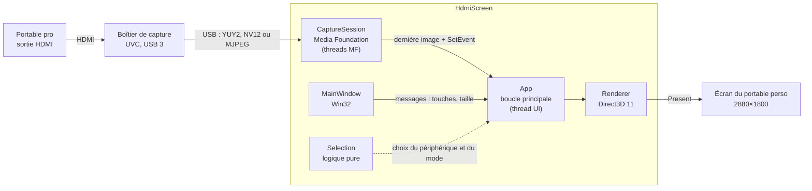
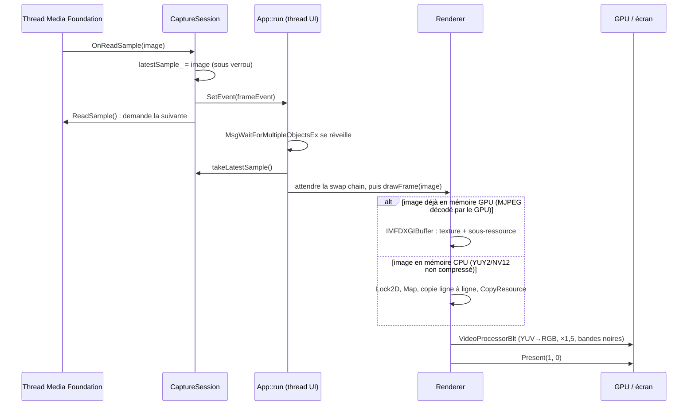
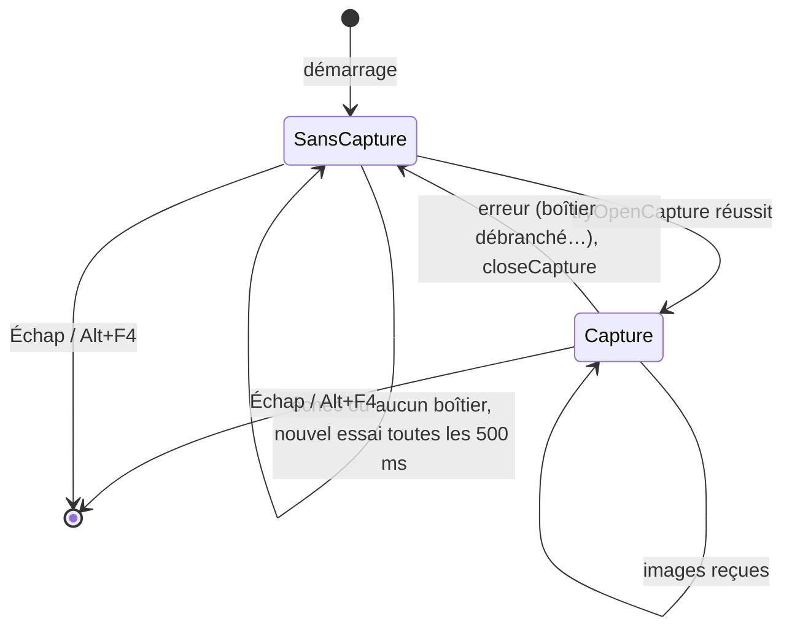

# Architecture de HdmiScreen

HdmiScreen est un seul exécutable de quelques fichiers. Trois briques (fenêtre, capture, rendu) sont assemblées par une quatrième (`App`), autour d'une logique de choix pure et testée. Ce document décrit qui fait quoi, comment une image traverse le programme et comment les cas d'erreur sont gérés.

Les API citées sont expliquées dans [API_WINDOWS.md](API_WINDOWS.md), et les notions de C++ dans [CPP_POUR_DEV_JAVA.md](CPP_POUR_DEV_JAVA.md).

## 1. Vue d'ensemble

## 2. Responsabilités des fichiers

| Fichier | Rôle | Dépend de Windows ? |
| --- | --- | --- |
| `main.cpp` | Point d'entrée : DPI, options, initialisation COM/MF, barrière d'exceptions | Oui |
| `App.h/.cpp` | Assemble les briques, boucle principale, reconnexion, commande `--list` | Oui |
| `MainWindow.h/.cpp` | Fenêtre Win32, plein écran sans bordure, clavier, curseur masqué | Oui |
| `CaptureDevices.h/.cpp` | Énumérer les périphériques, lire et appliquer leurs modes natifs | Oui |
| `CaptureSession.h/.cpp` | Objet COM : lecture asynchrone, conserve la dernière image | Oui |
| `Renderer.h/.cpp` | Direct3D 11 : swap chain, montée des images CPU, processeur vidéo | Oui |
| `ComUtils.h` | `ComPtr`, `HrError`/`throwIfFailed`, classes RAII, conversion UTF-8 | Oui |
| `Log.h/.cpp` | Journal : flux de débogage + console de l'invite | Oui |
| `VideoMode.h` | Description d'un mode (taille, fréquence, format) | **Non** |
| `Selection.h/.cpp` | Choix du mode et du périphérique | **Non** |
| `Geometry.h` | Rectangle d'affichage (bandes noires) | **Non** |
| `CommandLine.h/.cpp` | Analyse des options | **Non** |
| `tests/SelectionTests.cpp` | Tests de la logique pure | **Non** |

Séparer la logique pure de Windows permet de la tester partout (`ctest`) et de la lire sans connaître les API.

## 3. Threads

| Thread | Qui le crée | Ce qu'il exécute |
| --- | --- | --- |
| Principal (UI) | Windows, au lancement | `wWinMain`, `App::run`, la procédure de fenêtre, **tout le rendu** |
| Threads de Media Foundation | Media Foundation | `CaptureSession::OnReadSample`, `OnFlush`, `OnEvent` ; décodage MJPEG |

Les deux mondes ne partagent que trois choses, toutes dans `CaptureSession` :

- **la dernière image** (`latestSample_`), protégée par `mutex_` ;
- **l'erreur éventuelle** (`error_`, atomique) ;
- **l'événement `frameEvent`**, signalé par la capture et attendu par la boucle principale.

Le rendu ne s'exécute que sur le thread UI. Le périphérique D3D11 est malgré tout protégé (`SetMultithreadProtected`), car le décodeur matériel de Media Foundation l'utilise aussi.

## 4. Le trajet d'une image

**Pas de file d'attente.** Si une nouvelle image arrive avant que la précédente ait été affichée, elle la remplace. On préfère sauter une image plutôt qu'accumuler du retard : pour un écran de travail, c'est la fraîcheur qui compte. Avec `SetMaximumFrameLatency(1)` et l'attente sur l'objet de la swap chain, au plus une image est en attente d'affichage.

## 5. Choix du périphérique et du mode

### 5.1 Périphérique

Tous les périphériques vidéo sont ouverts et inspectés (`probeDevices`), puis notés par `scoreCaptureDevice` :

| Critère | Points | Pourquoi |
| --- | --- | --- |
| Propose au moins un mode ≥ 1920×1080 à ≥ 50 i/s | +2 | Rare pour une webcam intégrée, normal pour un boîtier HDMI |
| Nom sans mot typique de webcam (« Integrated », « Webcam », « IR camera »…) | +1 | Écarte la caméra du portable |

`chooseDevice` (`Selection.cpp`) applique ensuite trois règles :

1. **Le boîtier utilisé en dernier est repris en priorité** dès qu'il réapparaît (même lien symbolique), quel que soit son score : après une micro-coupure, on revient au même boîtier.
2. Sinon, **le meilleur score** l'emporte ; en cas d'égalité, le premier de la liste.
3. **Un score inférieur à 2 n'est jamais retenu automatiquement** (`kMinimumAutoScore`) : sans mode 1080p à 50 i/s ou plus, c'est presque sûrement une webcam. Mieux vaut l'écran « pas de signal » que la caméra du portable. Ces périphériques sont mémorisés et ne sont plus rouverts.

L'option `--device "texte"` restreint le choix aux périphériques dont le nom contient ce texte, et lève la règle 3 : c'est l'utilisateur qui décide.

### 5.2 Mode

`selectBestMode` compare les modes **critère par critère**, dans cet ordre (le premier qui départage gagne) :

1. **taille exactement égale à l'écran** : pixel pour pixel, aucune mise à l'échelle ;
2. **taille contenue dans l'écran** : on agrandit plutôt que réduire ;
3. **plus grande surface** : le plus de détails possible ;
4. **mêmes proportions que l'écran** : pas de bandes noires ;
5. **fréquence la plus haute**, plafonnée à 60 et arrondie (59,94 = 60) ;
6. **format** : NV12 > YUY2 > MJPEG.

Les formats inconnus (RGB, H.264…) sont ignorés. Sur ton portable (2880×1800), cela donne :

| Modes proposés par le boîtier | Mode retenu | Affichage |
| --- | --- | --- |
| … dont 1920×1200 @ 60 | 1920×1200 @ 60 (règles 3-4) | Plein écran, ×1,5, sans bande |
| 1920×1080 @ 60 en YUY2 et en MJPEG | 1920×1080 @ 60 YUY2 (règle 6) | ×1,5, bandes de 90 px en haut et en bas |
| 1920×1080 @ 30 YUY2 et @ 60 MJPEG | 1920×1080 @ 60 MJPEG (règle 5) | Fluide, mais texte moins net |

Ces cas sont couverts par `tests/SelectionTests.cpp`. Pour imposer un autre choix : `--mode 1920x1080@30`.

**Rappel côté portable pro** : il doit envoyer la même résolution que le mode capturé (Paramètres > Affichage). Sinon, c'est le boîtier qui redimensionne l'image, et le texte perd en netteté avant même d'arriver dans HdmiScreen.

## 6. Erreurs et reconnexion

| Situation | Détection | Réaction |
| --- | --- | --- |
| Aucun boîtier au démarrage (seulement la webcam) | `chooseDevice` ne trouve aucun périphérique de score ≥ 2 | Écran gris « pas de signal », nouvel essai toutes les 500 ms ; la webcam n'est jamais affichée |
| Micro-coupure USB : le boîtier disparaît puis revient (erreur `0xC00D3EA2`, `MF_E_VIDEO_RECORDING_DEVICE_INVALIDATED`) | `OnReadSample` en échec ou événement `MEVideoCaptureDeviceRemoved` | La session est fermée ; la dernière image reste affichée ; nouvel essai toutes les 500 ms, en reprenant le même boîtier dès qu'il réapparaît |
| Câble HDMI retiré (boîtier toujours branché) | Plus d'image pendant 3 s | Écran gris ; l'affichage reprend dès le retour du signal |
| Boîtier occupé par une autre appli | Échec à l'ouverture | Journalisé, nouvel essai toutes les 500 ms |
| Erreur Direct3D (GPU réinitialisé…) | Exception dans `drawFrame` | Message d'erreur et fin du programme (limite connue de cette version) |
| Exception dans la procédure de fenêtre | Barrière `try/catch` de `windowProc` | Journalisée, fin propre du programme |

Le gris très sombre de l'écran « pas de signal » permet de distinguer une absence de signal d'un écran noir réellement capturé. Il n'apparaît qu'après 3 s sans image, pour ne pas clignoter lors des micro-coupures.

**Micro-coupure USB ou HDMI ?** Une coupure du lien **USB** fait disparaître le boîtier de Windows (erreur `0xC00D3EA2`), puis Windows le redétecte en une à deux secondes. Une coupure du seul lien **HDMI** laisse le boîtier présent : les images s'arrêtent simplement, puis reprennent.

## 7. Limites connues et pistes

- **Agrandissement ×1,5** : sa qualité dépend du pilote du GPU. Piste : un shader bicubique/Lanczos avec léger renforcement de netteté.
- **Pas de texte à l'écran** (mode courant, i/s). Piste : Direct2D/DirectWrite par-dessus la swap chain (touche F1).
- **Perte du périphérique D3D** (mise à jour du pilote, GPU réinitialisé) : le programme s'arrête au lieu de recréer le rendu.
- **Pas de fichier de configuration** : les réglages passent par la ligne de commande. Piste : `hdmiscreen.ini` à côté de l'exécutable.
- **Inspection des périphériques** : à chaque tentative de connexion, les périphériques vidéo sont ouverts brièvement pour lire leurs modes (sans démarrer la capture), sauf ceux déjà écartés comme webcams.
- **Audio HDMI** : ignoré.
